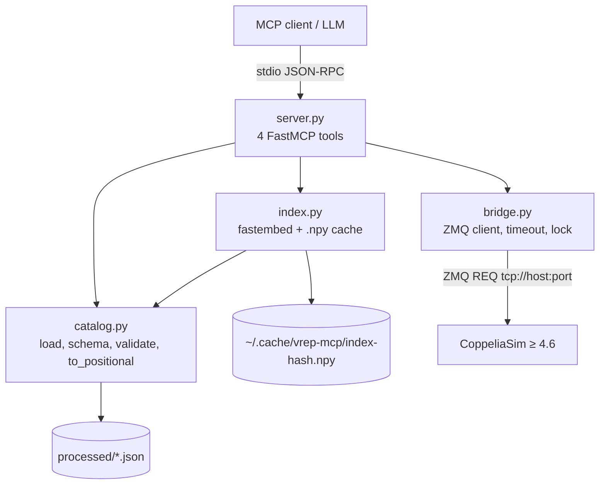

# vrep-mcp Design

**Spec**: `.specs/features/vrep-mcp/spec.md`
**Status**: Approved

---

## Architecture Overview

One Python package, `src/vrep_mcp/`, with 4 single-purpose modules. Catalog and index are pure, offline code. Only `bridge.py` touches the network. `server.py` is a thin FastMCP layer that turns `VrepError` into MCP tool errors.



### Approaches considered

| Approach                                                                     | Verdict                                                                                                    |
| ---------------------------------------------------------------------------- | ---------------------------------------------------------------------------------------------------------- |
| **A. Standalone package, 4 modules (catalog / index / bridge / server)**     | **Chosen.** Splits the offline-testable parts from the network part; builds on the existing draft.         |
| B. Single module (the current draft `catalog.py`)                            | Rejected: search, ZMQ timeout, and lock make one file do 4 things and block offline testing of the bridge. |
| C. Generate 576 native MCP tools and register them as an mcp-manager backend | Rejected: the user asked for a 4-tool server of its own; mcp-manager registration is out of scope.         |
| D. Import mcp-manager's `VectorStore`                                        | Rejected: couples two repos for about 30 lines of numpy code.                                              |

---

## Code Reuse Analysis

### Existing Components to Leverage

| Component                     | Location                                     | How to Use                                                                                                                                    |
| ----------------------------- | -------------------------------------------- | --------------------------------------------------------------------------------------------------------------------------------------------- |
| Draft catalog                 | `src/vrep_mcp/catalog.py`                    | Keep `entries`, `list_namespaces`, `schema`, `build_args`, `jsonable`; move ZMQ code to `bridge.py`; replace keyword `search` with `index.py` |
| Draft server                  | `src/vrep_mcp/server.py`                     | Keep the 4-tool shape; add `kind` param and error mapping                                                                                     |
| Draft tests                   | `tests/test_catalog.py`                      | Keep; rewrite assertions against spec IDs                                                                                                     |
| mcp-manager embedding pattern | `../mcp-manager/src/catalog/vector_store.py` | Same model id, text format `"<name>: <description>"`, cosine score ×100                                                                       |
| mcp-manager arg validation    | `../mcp-manager/src/tools/call_tool.py`      | Same required/type check idea (CALL-04/07)                                                                                                    |

### Integration Points

| System       | Integration Method                                                                                               |
| ------------ | ---------------------------------------------------------------------------------------------------------------- |
| CoppeliaSim  | `coppeliasim_zmqremoteapi_client.RemoteAPIClient(host, port, verbose=0)` → `client.require(ns)` → attribute call |
| MCP client   | FastMCP 2.x stdio (`mcp.run()`), script entrypoint `vrep-mcp`                                                    |
| Catalog data | `processed/*.json` read at first use                                                                             |

---

## Components

### catalog.py

- **Purpose**: Load the 5 JSON files into one `name → Entry` map and derive schemas and positional args.
- **Location**: `src/vrep_mcp/catalog.py`
- **Interfaces**:
  - `entries() -> dict[str, Entry]` - cached; raises `VrepError` on missing/invalid file (OPS-04)
  - `get(name) -> Entry` - raises `VrepError("Unknown function '<name>'. Use search_functions.")` (CAT-09, CALL-08)
  - `list_namespaces() -> list[dict]` (CAT-01)
  - `schema(name) -> dict` (CAT-02..08)
  - `to_positional(name, arguments) -> list` - validation CALL-04..07, mapping CALL-01
  - `catalog_hash() -> str` - SHA-256 over the 5 files' bytes, sorted by filename (SRCH-06)
- **Dependencies**: stdlib only
- **Reuses**: draft `entries`/`schema`/`build_args`

### index.py

- **Purpose**: Semantic search over all entries with a lazily built, hash-keyed disk cache.
- **Location**: `src/vrep_mcp/index.py`
- **Interfaces**:
  - `search(query, max_results=10, namespace=None, kind=None) -> list[dict]` (SRCH-01..05, 08..11)
  - `_vectors() -> np.ndarray` - loads `index-<hash16>.npy` or embeds and saves it (SRCH-06/07); row order = `sorted(entries())`
  - `_embedder()` - cached `fastembed.TextEmbedding(MODEL_ID)`; injectable for tests
- **Dependencies**: `fastembed`, `numpy` (fastembed dependency)
- **Reuses**: mcp-manager model id and text format

### bridge.py

- **Purpose**: Own the single ZMQ connection: lazy connect, receive timeout, serialization, reconnect.
- **Location**: `src/vrep_mcp/bridge.py`
- **Interfaces**:
  - `call(name, arguments) -> Any` - takes `_lock`, resolves entry, `to_positional`, `require(ns)`, invokes, `jsonable` (CALL-01..03, 09..12)
  - `_client()` - builds `RemoteAPIClient(host, port, verbose=0)`, sets `socket.RCVTIMEO = VREP_TIMEOUT*1000` and `LINGER = 0`
  - `_reset()` - closes socket/context, drops the cached client (CALL-10)
  - `jsonable(value)` - tuples → lists, bytes → base64, other → `repr` (CALL-02)
- **Dependencies**: `coppeliasim-zmqremoteapi-client`, `pyzmq` (transitive), `threading.Lock`
- **Reuses**: draft `_api`/`call`/`jsonable`

### server.py

- **Purpose**: Expose the 4 tools and map `VrepError` → `fastmcp.exceptions.ToolError`.
- **Location**: `src/vrep_mcp/server.py`
- **Interfaces**: `list_namespaces()`, `search_functions(query, max_results=10, namespace=None, kind=None)`, `get_function_schema(name)`, `call_function(name, arguments=None)`, `main()`
- **Dependencies**: `fastmcp>=2,<3`
- **Reuses**: draft server; instructions text mirrors mcp-manager flow (search → schema → call)

---

## Data Models

```python
class Entry(TypedDict):
    name: str            # "sim.getObject"
    kind: Literal["function", "constant"]
    namespace: str       # sim | simUI | simROS2 | simVision
    method: str          # "getObject"
    description: str
    url: str | None
    signature: str       # python_raw, or lua_raw fallback (CAT-07); "" for constants
    params: list[dict]   # [{"param_type","param_name"}], python or lua fallback
    param_docs: list[str]  # aligned docs or [] when misaligned (CAT-05/06)
    returns: list[dict]
    type: str | None     # constants only ("int")
```

Embedding cache: `numpy` float32 matrix `(975, 384)`, L2-normalized at build, saved with `np.save`. Row _i_ ↔ `sorted(entries())[i]`. The hash covers the catalog bytes, so row order cannot drift without the file changing.

---

## Error Handling Strategy

| Error Scenario                                    | Handling                                           | User Impact                                                                        |
| ------------------------------------------------- | -------------------------------------------------- | ---------------------------------------------------------------------------------- |
| Unknown name                                      | `catalog.get` raises `VrepError`                   | `Unknown function '<name>'. Use search_functions.`                                 |
| Bad args (missing / unknown / gap / type)         | `to_positional` raises before any network I/O      | Exact messages in CALL-04..07                                                      |
| Simulator down / slow                             | `zmq.Again` on `recv` → `_reset()` → `VrepError`   | CALL-09 message with host, port, timeout                                           |
| Simulator error reply                             | client raises `Exception(err)` → `VrepError`       | `CoppeliaSim error in <name>: <message>`                                           |
| Function missing in connected CoppeliaSim version | `AttributeError` on namespace object → `VrepError` | `CoppeliaSim error in <name>: function not available in the connected CoppeliaSim` |
| Catalog file missing/invalid                      | `entries()` raises `VrepError`                     | OPS-04 message                                                                     |
| Model download fails on first search              | fastembed exception → `VrepError`                  | `Search index unavailable: <reason>`; other 3 tools keep working                   |
| Invalid search params                             | `index.search` validates first                     | SRCH-08..11 messages                                                               |

---

## Risks & Concerns

| Concern                                                                        | Location (file:line)                                                  | Impact                                      | Mitigation                                                                                                                  |
| ------------------------------------------------------------------------------ | --------------------------------------------------------------------- | ------------------------------------------- | --------------------------------------------------------------------------------------------------------------------------- |
| Client `_recv` blocks forever (no timeout)                                     | `coppeliasim_zmqremoteapi_client/__init__.py` `RemoteAPIClient._recv` | Server hangs when CoppeliaSim is down       | Set `RCVTIMEO` on `client.socket`; on `zmq.Again` discard the client, because a REQ socket is unusable after a missed reply |
| Client prints to stdout when `VERBOSE` env > 0                                 | `RemoteAPIClient.__init__` / `_recv`                                  | Corrupts the stdio JSON-RPC stream (OPS-02) | Always pass `verbose=0`                                                                                                     |
| Client constructor writes `require` into `__main__` globals                    | `RemoteAPIClient.__init__`                                            | Harmless global side effect                 | Accept; document in code comment (`hazard:`)                                                                                |
| Doc-derived types may differ from runtime (`list` vs `dict`, `buffer`)         | `processed/sim.json`                                                  | Valid calls rejected by CALL-07             | Exotic types get no `type` constraint (CAT-04); only the 6 basic types are checked                                          |
| 14 entries without `python_raw`                                                | `processed/sim.json` (e.g. `serialRead`)                              | Wrong required set                          | Lua fallback (CAT-07), covered by a test                                                                                    |
| 123 misaligned `params_definitions`                                            | `processed/sim.json`                                                  | Wrong param docs                            | Omit docs (CAT-06)                                                                                                          |
| First search downloads the embedding model (hundreds of MB, size not verified) | `index.py`                                                            | Slow first search, fails offline            | Lazy (OPS-03); actionable error; later searches use the cache                                                               |
| Draft code lacks the lock, timeout, and kind filter                            | `src/vrep_mcp/catalog.py:126`                                         | Spec gaps                                   | Tasks T4, T5, T6, T7                                                                                                        |
| No e2e against real CoppeliaSim in CI                                          | n/a                                                                   | Bridge bugs found late                      | Manual smoke task T10, gated on a running simulator                                                                         |

---

## Tech Decisions

| Decision          | Choice                                                          | Rationale                                                                                              |
| ----------------- | --------------------------------------------------------------- | ------------------------------------------------------------------------------------------------------ |
| Index storage     | `.npy` matrix, not SQLite like mcp-manager                      | 975 static rows; one `np.save`/`np.load`; the hash in the filename removes the need for per-row upsert |
| Timeout mechanism | `zmq.RCVTIMEO` on the client's socket + reset                   | The client has no timeout API; REQ sockets need a reset after a timeout                                |
| Error type        | One `VrepError(Exception)` mapped to `ToolError` in `server.py` | Domain modules stay free of FastMCP                                                                    |
| Serialization     | Module-level `threading.Lock` around `bridge.call`              | One REQ socket; FastMCP may run sync tools in worker threads                                           |
| Test injection    | `bridge.call(..., api=...)` and `index._embedder` swap          | Offline tests with no simulator or model download                                                      |
